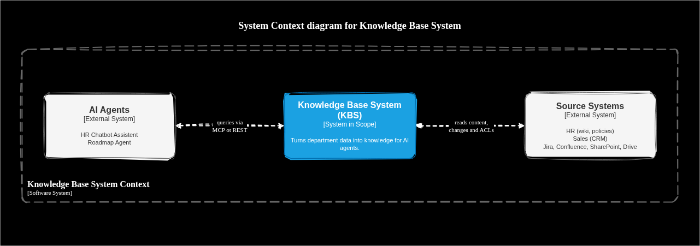
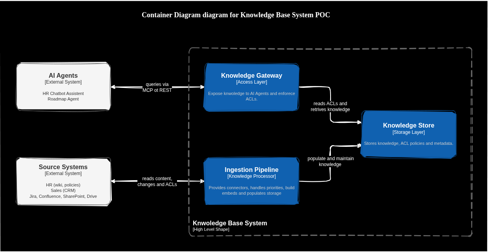
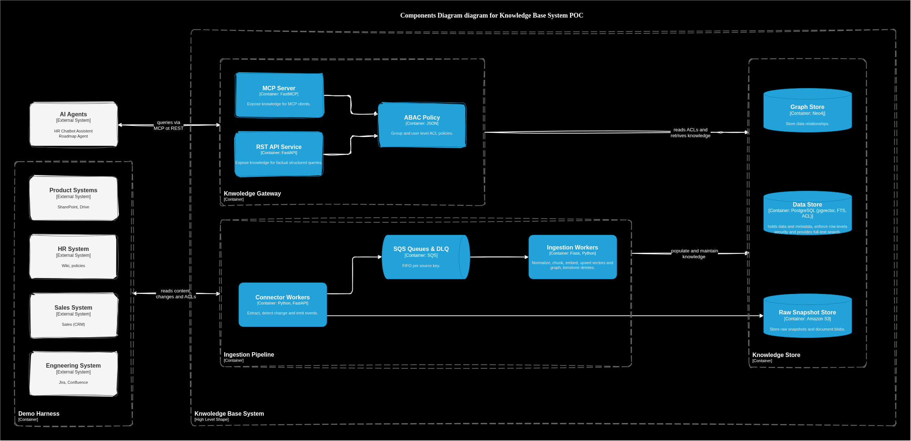

# Project Brief

## Context

A global company has its operational knowledge spread across many systems, owned by different departments and stored in different shapes. Each department (Sales, Product, Engineering, Finance, People, and others) owns its own sources. Those sources are updated continuously and independently: records are created, edited, or deleted every day, with no central coordination and no common schema.

The company wants to build AI agents that automate process workflows across departments. Two examples:

- A chatbot that lets employees query HR information (policies, procedures, benefits) in natural language.
- An agent that connects information from Sales, Engineering, and Product to produce data-driven roadmaps.

None of these agents exist yet. To build them reliably, agents need knowledge that is accurate, current, and authorized at the moment they act. Today there is no system that provides this.

The POC implements one slice of that system: a knowledge gateway that ingests four department sources, keeps a hybrid index (vector plus knowledge graph) current from change events, and exposes the result to agents through one API and one MCP server. Production scale, additional departments, and a full agent product are documented as a production path and are not built.

## Explicit requirements

- Handle data from distributed sources that belong to different departments, with different formats, access methods, and ownership.
- Transform that data into knowledge that AI agents can interpret and use.
- Expose the knowledge to AI agents through a consistent access layer.
- Maintain itself over time, reflecting additions, modifications, and deletions in the source systems without manual re-indexing.

## Implicit requirements

- Make the knowledge available to multiple future agents so that every team does not implement its own connectors, document processing, permissions, retrieval, and synchronization.
- Reduce the effort required to discover and use organizational knowledge, and make it safer and cheaper to introduce new AI-enabled workflows.

## Product principles

1. Authorization before relevance. A highly relevant document is never a valid result if the requester is not allowed to see it.
2. Source systems remain authoritative. The platform indexes and organizes knowledge. It does not replace source ownership or become the system of record.
3. Freshness is measurable. Every indexed item carries synchronization and source-version metadata, and freshness objectives can be monitored.
4. One access contract, multiple integrations. Agents consume a stable interface and do not connect directly to every department's systems.
5. Deterministic controls, probabilistic intelligence. Conventional code owns permissions, synchronization, deletion, validation, and state transitions. Language models are used where language understanding or semantic extraction adds value.

## Primary users and jobs to be done

| User / consumer               | Need                                                           | Expected outcome                                   |
| ----------------------------- | -------------------------------------------------------------- | -------------------------------------------------- |
| Employees                     | Ask questions about company policies and procedures            | Accurate answers with traceable sources            |
| Department owners             | Publish and maintain operational knowledge in existing systems | No duplicate manual knowledge management           |
| AI agents                     | Retrieve authorized facts from multiple departments            | Consistent, machine-readable context               |
| Platform engineers            | Add and maintain integrations                                  | Reusable connectors and observable synchronization |
| Security and governance teams | Enforce access restrictions and trace usage                    | Auditable, policy-compliant access                 |

## Assumptions

Two sets of assumptions are stated separately. The interview discussion starts from the production set. The POC is sized to the second set and does not claim to have proven the first.

### Stated production assumptions

| Topic | Assumption |
| ----- | ---------- |
| Scale | About 2,000 active employees and about 10 million objects (documents, records, emails, spreadsheets) across Sales, Product, Engineering, and People/HR. |
| Change volume | About 100,000 creations, modifications, or deletions per day. |
| Freshness | High-priority security and HR policy: propagation under 30 seconds. Operational content (Jira, Confluence): under 5 minutes. Bulk historical archives: batch sync every 24 hours. |
| Security | Zero-trust, user-delegated access. Downstream agents hold no elevated privilege. Every query inherits the initiating user's identity, entitlement scopes, and access-control attributes. HR data that contains compensation or national identifiers is subject to attribute-based access control. |
| Query types | Unstructured semantic search ("What is our parental leave policy in Germany?") and structured multi-hop traversal ("Which high-ARR Sales deals in Q3 depend on unreleased Engineering epics?"). |
| Heterogeneity | Unstructured: HR policies (PDF/DOCX), product specs (Notion/Confluence), sales transcripts. Semi-structured: financial JSON APIs, engineering work items. Structured: sales CRM records, people directory. |
| Latency | Unified retrieval under 250 ms p95, excluding language-model generation time. |

Sanity check on volume. 100,000 events per day is about 1.2 events per second on average. Peak bursts of 10 to 20 times the average are still well inside a single queue and a small worker pool. The production constraint is embedding cost, rate limits on source APIs, and delete correctness, not raw throughput. A design that starts with Kafka, a dedicated vector cluster, and multi-region replication is solving a problem this volume does not have.

### POC scaling assumptions

| Topic | POC assumption |
| ----- | -------------- |
| Sources | Four mocked department services: HR, Sales, Product, Engineering. |
| Corpus | A few hundred documents and records, enough to show citations, permission boundaries, and a multi-hop graph question. |
| Freshness | The same three tiers exist as queue priority and a measured sync-lag metric. The 30-second and 5-minute targets are demonstrated on the local stack. They are not load-tested. |
| Identity | A mock identity provider issues signed JWTs with department, clearance, and region claims. |
| Language models | OpenRouter via `OPENROUTER_API_KEY` and model names in config. Offline runs use a local embedder and a deterministic stub extractor. |
| Infrastructure | Docker Compose plus [floci](https://floci.io) for AWS emulation (SQS, S3, EventBridge Scheduler). Terraform talks to floci endpoint overrides. |

## Questioned requirements

These are places where the stated requirements need a narrower reading before implementation.

- The 30-second freshness SLA holds only for sources that can push (webhook or change feed). A source that only supports polling cannot meet 30 seconds without polling faster than its rate limits allow. Freshness is a per-source contract, not a platform-wide promise.
- The 250 ms p95 retrieval budget covers hybrid search (vector plus full-text) with an authorization filter. Adding a cross-encoder reranker or an unbounded graph expansion inside that budget is a separate decision, made only after retrieval metrics show a gap.
- "Without manual intervention" means no human re-indexes the corpus. It still requires an owner per connector, a dead-letter queue, and a reconciliation job. Silent failure is the failure mode this system has to make visible.
- Compensation figures and national identifiers are a poor fit for a retrieval index even with attribute-based access control. The safer decision is data minimization: do not ingest those fields. The POC directory contains role, team, and region, and omits compensation and identifiers.
- A knowledge graph pays for itself on the multi-hop question. It does not pay for itself on policy prose. The graph ontology stays small and typed. Open-ended prose stays in chunks.

## POC scope

### Use cases that the demo must answer

1. HR policy chatbot. "What is our parental leave policy in Germany?" returns an answer with a citation to the policy chunk, its source version, and its sync time.
2. Cross-department roadmap question. "Which high-ARR Sales deals in Q3 depend on unreleased Engineering epics?" returns deals, epics, and the path that connects them (deal, account, product spec, epic, owning team).

### In scope (built)

- Four source connectors behind one interface, each with a written data contract.
- Change detection that matches the source: polling, cursor feed, webhook, and updated-since listing.
- An event pipeline: connector workers, SQS with a dead-letter queue, ingestion workers.
- Hybrid retrieval: Postgres with pgvector and full-text search, merged with reciprocal rank fusion.
- A Neo4j knowledge graph with a small ontology, populated deterministically from structured records and by a constrained extractor from product specs.
- One service layer exposed twice: a REST API and an MCP server (`search_knowledge`, `get_document`, `find_related`, `list_sources`).
- User-delegated authorization: JWT claims, coarse pre-filter in SQL and Cypher, fine-grained post-check, Postgres row-level security, and an audit record of which attributes justified a result.
- Delete propagation, content-hash skip, idempotent upserts, and a reconciliation sweep.
- A demo harness: FastAPI services with SQLite and files for HR, Sales, Product, and Engineering, plus a mutation script.
- Docker Compose, floci, Terraform for queues, buckets, and secrets, and one Grafana dashboard (sync lag, queue depth, dead-letter depth, retrieval latency, empty-result rate by permission group).
- A golden evaluation set of about 20 questions, including questions with no answer, conflicting sources, and access-boundary cases.

### Out of scope (production path, documented only)

Finance and other departments beyond the four. Real OAuth against Google, Notion, Jira, HubSpot, or Workday. Gong or Zoom transcripts. Multi-region deployment. A cross-encoder reranker. Community-summary GraphRAG. Kafka or Kinesis. A product UI beyond a small chat page or CLI. Compensation and national-identifier fields.

## Target stack

| Concern | POC choice |
| ------- | ---------- |
| Language and HTTP | Python, FastAPI. The Knowledge API and the MCP server are thin adapters over one service layer. |
| Metadata, vectors, lexical search, authorization | Postgres: source registry, ACL attributes, sync state, content hashes, pgvector, full-text search, row-level security. |
| Knowledge graph | Neo4j. |
| Messaging | SQS on floci, FIFO per source key so updates for one object stay ordered, plus a dead-letter queue. |
| Object storage | S3 on floci for raw snapshots and document blobs. |
| Scheduling | EventBridge Scheduler on floci for poll cadence. |
| Workers | Connector workers (extract, detect change, emit). Ingestion workers (normalize, chunk, embed, upsert vectors and graph, tombstone deletes). |
| Models | OpenRouter for chat and, when configured, embeddings. Local fallback embedder (fastembed or sentence-transformers) and a deterministic stub extractor for offline runs. |
| Identity | Mock IdP issuing signed JWTs with department, clearance, and region claims. |
| Infra | Docker Compose. Terraform with floci endpoint overrides for queues, buckets, and secrets. |
| Observability | OpenTelemetry, Prometheus, Grafana. One dashboard. |

## Demo script

The demo is the acceptance test. Each step is observable in the API response, the graph path, or the dashboard.

1. Ask the Germany parental-leave question as an employee who is allowed to read HR policies. The answer cites the policy chunk, source version, and last sync time.
2. Ask the same question as a user whose claims do not include that policy. The result set is empty. The audit log records the deny. The empty-result rate for that permission group moves.
3. Ask which high-ARR Q3 deals depend on unreleased engineering epics. The answer lists deals and epics and returns the path (deal, account or spec, epic, team).
4. Edit a policy and delete a deal in the demo harness. Within the source's freshness tier, the edited chunk is re-embedded (content hash changed) and the deleted deal disappears from Postgres and Neo4j. Sync lag for that source is visible.
5. Stop an ingestion worker mid-batch, then start it again. In-flight messages return to the queue or land in the dead-letter queue. Replaying them does not duplicate chunks or edges, because the upsert key is source id plus version or content hash.

Makefile targets that support the script: `up`, `seed`, `demo`, `test`, `eval`.

## Risks and open questions

- floci covers SQS, S3, and EventBridge well enough to show the pipeline. It does not emulate Bedrock, IAM evaluation, or production queue semantics under load. Model calls go to OpenRouter or the local fallback, not to a mocked AWS model API.
- Two stores (Postgres and Neo4j) can diverge. The document in Postgres is the authority for prose. The graph is a derived index. A failed graph write must not leave a vector chunk that claims a relationship the graph does not have; the ingestion worker writes both inside one unit of work and retries the pair.
- LLM extraction of edges from product specs will be wrong some of the time. Every extracted edge carries confidence and a source span. The demo question is answered from deterministic edges extracted from structured records. Extracted edges are visible and are not trusted for the headline answer.
- Permission propagation has a window. High-sensitivity sources re-check the ACL against the source at read time. Lower-sensitivity sources accept the sync window and document it on the contract. The POC shows both behaviors on HR (re-check) and Product (window).
- Entity resolution beyond shared ids and email addresses is deferred. If Sales and Engineering use different identifiers for the same product, the demo data uses one shared product key on purpose. Production will need a resolution step; pretending the demo key is that step would be dishonest.
- The 250 ms budget and the 30-second SLA are design targets with a metric, not a load-test result.

## Repo layout

| Path | Role |
| ---- | ---- |
| `_docs/00--project-brief/` | This brief, the C4 system-context diagram, and the [C4 container diagram](01-c4-l2--container-connectors.png) for connector workers. |
| `_docs/01--spikes/` | Decision records for ingestion, knowledge representation, access, and synchronization. |
| `_docs/02--architecture/` | Architecture document. Outline only until the next pass. |
| `_docs/03--adrs/` | Short ADRs for storage, observability, and embedding/chunk versioning. |
| `backend/apis` | Knowledge API and MCP server adapters. |
| `backend/services` | Retrieval, authorization, and ingestion service layer. |
| `backend/workers` | Connector and ingestion workers. |
| `backend/messaging` | Queue contracts and event types. |
| `backend/functions` | Small pure functions (chunking, fusion, hashing). |
| `database` | Postgres and Neo4j schema. |
| `demo-harness/` | HR, Sales, Product, and Engineering mock services. |
| `infrastructure/` | Compose orchestration, Terraform provisioning, floci config, and `config/sources` YAML contracts. |
| `observability` | One dashboard and metric definitions. |
| `shared` | Contracts shared by the harness and the gateway. Source contracts in `shared/contracts` are checked by `make contracts-check`. |
| `tools` | Seed, mutation, and evaluation scripts. |

## Related decisions

- [Spike 01: connecting heterogeneous sources](../01--spikes/01--handling-data-from-distributed-sources-w-diff-formats-access-methods-n-ownership.md)
- [Spike 02: knowledge representation](../01--spikes/02--transforming-data-into-knowledge-that-ai-agents-can-easily-interpret-and-use.md)
- [Spike 03: agent access layer](../01--spikes/03--exposing-knowledge-to-ai-agents-though-consistent-access-layer.md)
- [Spike 04: self-maintenance](../01--spikes/04--self-maintaing-over-time-refelcting-additions-modifications-n-deletions-in-the-source-systems-without-manual-intervention.md)
