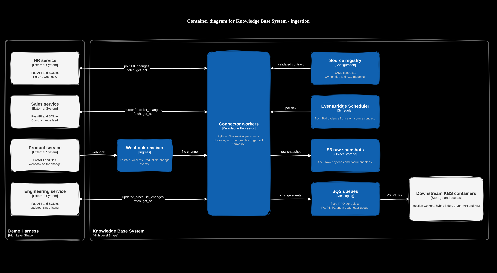

# Spike 01: Connecting heterogeneous sources

Status: decision for the POC. Production scale is called out and is not built.

## Problem

Each department's source is the product of decisions made independently, years apart, with no shared schema, authentication, or notion of what a document is. Support might be HTML in Zendesk, legal might be PDFs in a records system, engineering might be markdown in git, and product might be a Notion workspace that changes every hour. Departments also update, delete, and tolerate staleness at different rates.

The difficulty is organizational, and the failure mode that matters most is access control. A gateway that flattens departmental permissions into one undifferentiated index is a data leak. A gateway that adds every source it can reach, without an owner and a freshness contract, fails quietly: stale connectors degrade answers until a user notices.

The POC has to ingest four sources that differ on purpose, attach a normalized permission attribute at ingestion, and keep source-specific quirks out of retrieval.

## Decision (MVP)

Build a connector service-provider interface and a registry of per-source data contracts. Orchestration (schedule, retry, deduplication against the last sync) stays in the workers. Extraction stays in the connector.

Connector interface:

| Method | Responsibility |
| ------ | -------------- |
| `discover` | List the object types this source exposes and the capability flags it supports. |
| `list_changes` | Return a page of creates, updates, and deletes since a cursor, timestamp, or snapshot id. |
| `fetch` | Return the current body and metadata for one object. |
| `get_acl` | Return the source's native permission, already mapped toward the platform attribute set. |
| `normalize` | Emit the platform document: stable source id, version, content hash, text or record payload, and ACL attributes. |

Capability flags on each contract: `webhook`, `cursor_feed`, `updated_since`, `snapshot_diff`. A connector implements the cheapest flag the source actually has. The four demo sources are chosen so each flag is exercised once:

| Source | Shape | Change signal | Sensitivity |
| ------ | ----- | ------------- | ----------- |
| HR | Markdown and PDF policies, plus a SQLite people directory | Poll, no webhook | High. ACL re-checked at read time. |
| Sales | SQLite CRM (accounts, deals) | Cursor-based change feed | Medium. Team scope. |
| Product | Markdown specs on disk | Webhook on file change | Low. Bounded sync window. |
| Engineering | Jira-like epics in SQLite | `updated_since` listing | Medium. Project membership. |

Each source ships a YAML contract in [infrastructure/config/sources](../../infrastructure/config/sources). Attributes are attached to the document at ingestion. Retrieval evaluates them as a policy decision. The audit log records which attributes justified showing a chunk to a user. See [ADR 0001](../03--adrs/0001-storage.md) and [spike 03](03--exposing-knowledge-to-ai-agents-though-consistent-access-layer.md).

### Container view

Connector workers sit against the four harness services. The harness is outside the gateway. Downstream containers are inside the boundary and drawn grey because this view does not open them. Blue boxes are the ingestion containers.

Source: [01-c4-l2--container-connectors.drawio](../00--project-brief/01-c4-l2--container-connectors.drawio).

### Contract fields

The Pydantic model in [shared/contracts/source_contract.py](../../shared/contracts/source_contract.py) is the source of truth. JSON Schema is generated next to it. `make contracts-check` validates the four YAML files, runs the registration tests, and fails if the committed schema drifted. GitHub Actions runs that target on changes under `shared/contracts` and `infrastructure/config/sources`. Worker bootstrap must call `shared.contracts.validate.load_contracts` and must refuse to start a connector that has no valid contract.

| Field | Rule |
| ----- | ---- |
| `owner.team`, `owner.contact` | Required. A connector with no owner does not register. |
| `freshness_tier` | `P0`, `P1`, or `P2`. Required. |
| `freshness_target_seconds` | At most 30 / 300 / 86400 for P0 / P1 / P2. |
| `capabilities` | At least one of `webhook`, `cursor_feed`, `updated_since`, `snapshot_diff`. P0 cannot be `snapshot_diff` alone. |
| `acl_mapping` | At least one rule. Each rule maps a native permission to one or more of `department`, `clearance`, `region`, `group`. |
| `sensitivity` | `high` requires `acl_recheck_at_read: true`. |
| `in_scope_fields` | Required, and must not include `salary`, `compensation`, `ssn`, or `national_id`. |
| `excluded_fields` | Disjoint from `in_scope_fields`. |

Chunking is format-aware and registered per source type (markdown by heading, PDF by section, records as one chunk per row plus a short textual rendering). A single fixed-size splitter is not used. Chunks carry source, section path, version, timestamp, ACL attributes, `embedding_model`, and `chunker_version`. See [ADR 0003](../03--adrs/0003-embedding-and-chunk-versioning.md).

Ingestion health is a first-class metric: sync recency per source, failed syncs, and document drift (source count versus indexed count). Stale data fails silently otherwise. See [ADR 0002](../03--adrs/0002-observability.md).

## Why

- Source-specific complexity (auth, pagination, format quirks) stays inside the connector and does not leak into normalization or retrieval.
- A written contract makes freshness and sensitivity explicit. The 30-second tier is only offered to a source whose capability flag can support it.
- Normalizing permissions at ingestion, and enforcing them at query time, keeps authorization in the data path. A post-hoc filter in the prompt cannot do that.
- Four connectors with owners beat a long list of unowned ones. Every connector is an ongoing commitment: API changes, expired tokens, rate limits, schema drift.

## Alternatives rejected

| Alternative | Why it was rejected for the POC |
| ----------- | ------------------------------- |
| Airbyte or Fivetran style ELT | Solves extract-and-load into a warehouse. It does not own ACL normalization, delete tombstones, or per-source freshness contracts, which are the actual problem. Adopting it would hide the design the assignment is grading. |
| Federated query at read time | Leaves data in the source and queries live. Attractive for freshness, and wrong for agents: latency, rate limits, and partial failure become the user's query. Indexing with a measured lag is the better contract. A live ACL re-check remains for high-sensitivity sources only. |
| One universal chunker | Fixed token windows cut tables, headings, and code. Retrieval quality drops in a way that looks like a model problem. Format-aware chunkers cost a small registry and avoid that. |
| Ingest every available field, including compensation and national identifiers | Technically possible and a poor risk trade. Those fields are out of the contract. See the brief. |

## Trade-offs and risks

- Freshness versus cost. Re-embedding every change is the expensive step. Content-hash skip (spike 04) avoids re-embedding unchanged bodies. Real-time sync is reserved for the high-priority tier.
- Up-front translation per connector. A normalized, source-agnostic metadata schema costs mapping code in each connector. That cost is paid once and keeps retrieval free of source types.
- Over-indexing. Adding a fifth source is a product decision (owner, tier, sensitivity, retrieval value), not a default because the API exists.
- The demo sources are cooperative. They implement the capability the connector expects. A real Jira or Drive connector will spend its budget on pagination, auth refresh, and rate limits. The interface is what transfers; the demo adapters are not evidence that those connectors are cheap.

## Production path

- Real connectors implement the same interface against Drive, Jira, HubSpot, and a people directory, with OAuth token refresh and rate-limit backoff.
- The registry becomes a reviewed config change with an owner who is accountable for accuracy of what gets indexed from their system.
- Sensitivity classification gates whether a field may be embedded at all.
- Connector version and source API version are recorded on each sync run so a breaking upstream change is attributable.

## Open TODOs

- Connector worker code that calls `load_contracts` at startup and implements `discover`, `list_changes`, `fetch`, `get_acl`, and `normalize`.
