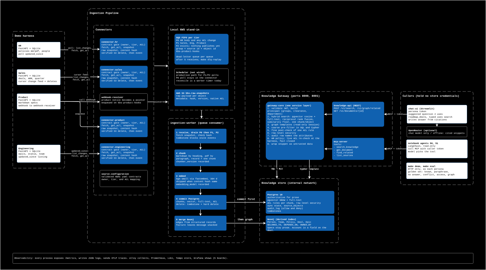
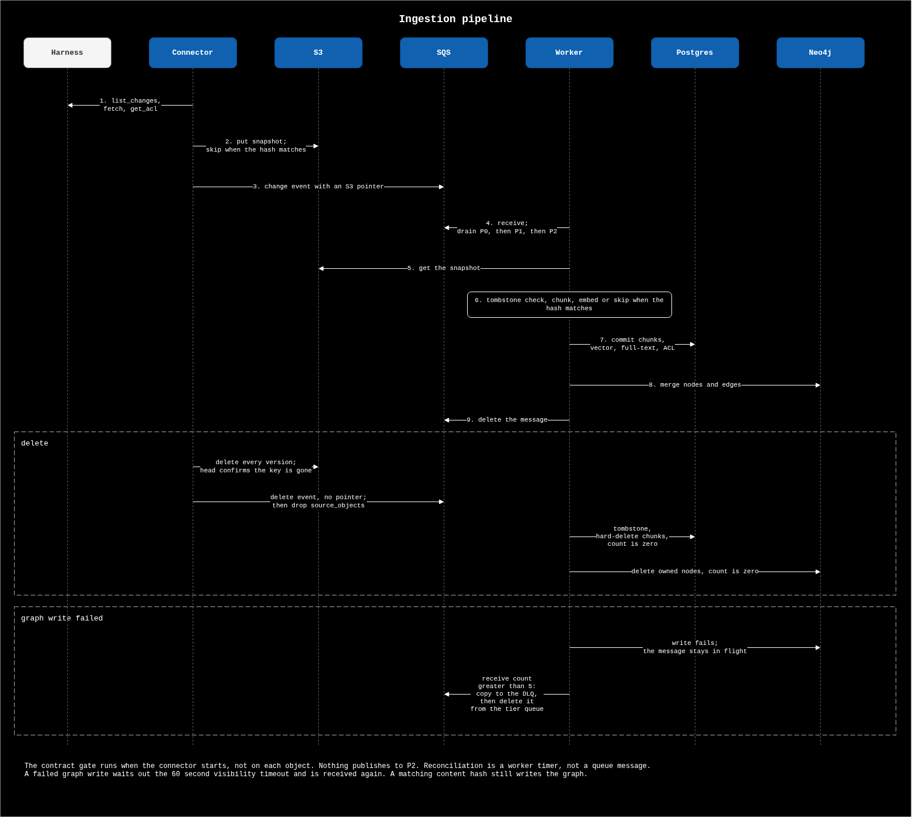
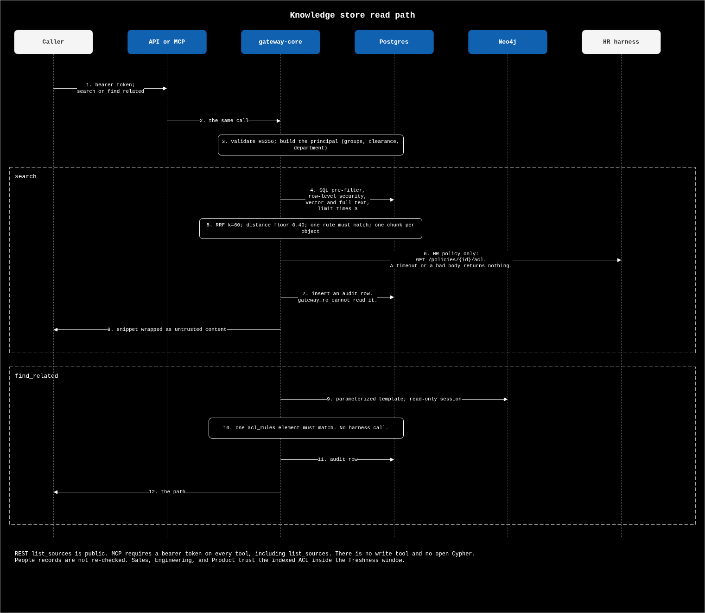
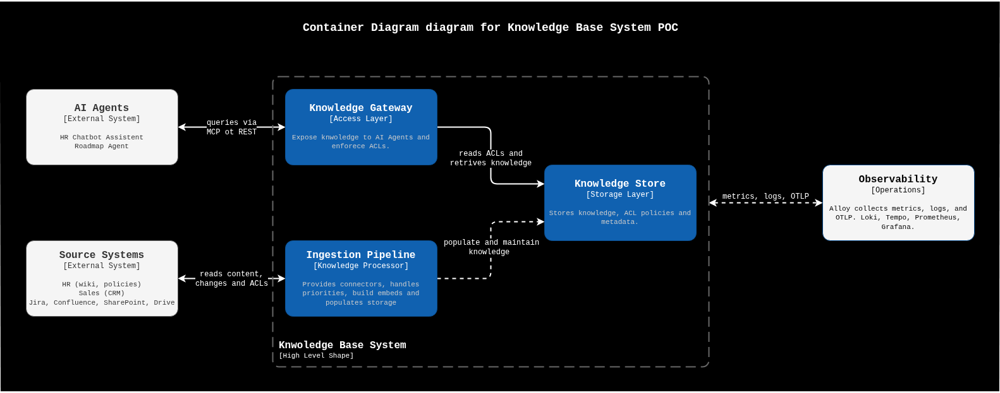
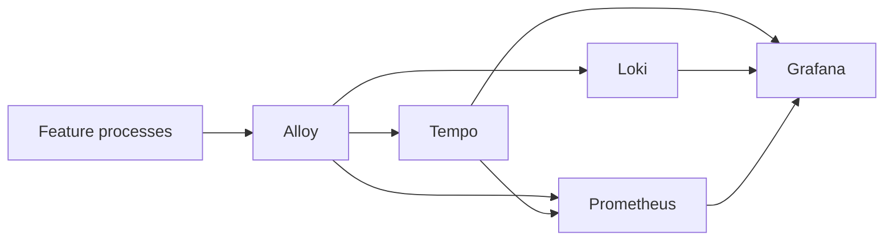
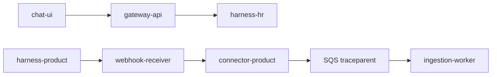

# Architecture Document: Knowledge Base Gateway

It answers the assignment's eight questions and states its assumptions. Long-form reasoning lives in the [project brief](../00--project-brief/00-project-brief.md), the [spikes](../01--spikes/), and the [ADRs](../03--adrs/README.md). The POC and the AI-SDLC description are Deliverable 2 ([README](../../README.md#how-ai-was-used)).

## Executive summary

Departments own sources that change independently and have no shared schema. Agents need knowledge that is accurate, current, and authorized at the moment they act. The design is a knowledge gateway:

- Connectors detect changes at each source and emit events onto priority queues.
- Workers normalize, chunk, embed, and upsert into Postgres (prose, lineage, permissions, hybrid search) and a derived Neo4j graph (a small typed ontology).
- One service layer sits behind a REST API and an MCP server. Authorization runs in the data path under the caller's identity. Agents hold no store credentials and have no write tools.
- Deletes are hard deletes with verification and a reconciliation backstop.

The POC proves this on four mocked sources and two questions:

1. "What is our parental leave policy in Germany?" Answered from authorized chunks, with a citation to the chunk, version, and sync time.
2. "Which high-ARR Sales deals in Q3 depend on unreleased Engineering epics?" Answered from a graph path (deal, account or spec, epic, team).

## Assumptions

The discussion starts from the production set. The POC is sized to the second set and does not claim to have proven the first.

| Topic          | Production assumption                                                                                                                                                                                                      | POC assumption                                                                                                                                             |
| -------------- | -------------------------------------------------------------------------------------------------------------------------------------------------------------------------------------------------------------------------- | ---------------------------------------------------------------------------------------------------------------------------------------------------------- |
| Scale          | About 2,000 employees, about 10 million objects across Sales, Product, Engineering, and HR.                                                                                                                                | Four mocked sources, a few hundred documents and records.                                                                                                  |
| Change volume  | About 100,000 changes a day, about 1.2 per second on average. Bursts of 10 to 20 times are still within one queue and a small worker pool. The constraints are embedding cost, source rate limits, and delete correctness. | Same pipeline, demo volume.                                                                                                                                |
| Freshness      | HR policy and security: under 30 seconds. Jira and Confluence: under 5 minutes. Archives: daily.                                                                                                                           | Same three tiers as queue priority plus a sync-lag metric. Demonstrated locally, not load-tested.                                                          |
| Security       | Zero-trust, user-delegated access. Every query inherits the caller's identity and attributes. Agents hold no elevated privilege.                                                                                           | Mock identity provider signing JWTs with department, clearance, region, and group claims.                                                                  |
| Queries        | Semantic search and multi-hop traversal.                                                                                                                                                                                   | The two demo questions.                                                                                                                                    |
| Latency        | Under 250 ms p95 for retrieval, excluding model generation.                                                                                                                                                                | A design target with a metric, not a load-test result.                                                                                                     |
| Infrastructure | Not specified.                                                                                                                                                                                                             | Docker Compose, [floci](https://floci.io) for SQS, S3, and EventBridge Scheduler, Terraform against floci.                                                 |
| Models         | Not specified.                                                                                                                                                                                                             | Local `multilingual-e5-large` for embeddings (1024 dimensions). OpenRouter for chat when a key is set, and for a low-confidence route when a router model is set. A hash embedder and a deterministic extractor for offline runs and tests. |

Requirements I narrowed, and why:

- The 30-second target holds only for a source that can push, or be polled that fast. Freshness is a per-source contract, not a platform promise. EventBridge Scheduler cannot fire faster than once a minute, so the P0 poll loop lives in the connector worker.
- The 250 ms budget covers hybrid search with an authorization filter. A reranker or unbounded graph expansion is a separate decision, made only if metrics show a gap.
- "Without manual intervention" means no human re-indexes the corpus. It still needs a named owner per connector, a dead-letter queue, and a reconciliation job.
- Compensation figures and national identifiers are not ingested (`salary`, `compensation`, `ssn`, `national_id`). Data minimization is safer than attribute-based access on a retrieval index.
- The graph is used for the multi-hop question only. Policy prose stays in chunks.

## Architecture

The diagram above shows every component, the flow from source to agent, and the transformation at each hop. The C4 views below zoom in. The sequence diagrams are the ordered calls: [ingestion](../99--dagrams/03-sequence--ingestion-pipeline.drawio) and the [knowledge-store read path](../99--dagrams/04-sequence--knowledge-store-flow.drawio).

Further views (the end-to-end diagram source is [02-end-to-end-data-flow.drawio](../99--dagrams/02-end-to-end-data-flow.drawio)): [system context](../99--dagrams/00-c4-l1--system-context.png), [connector containers](../99--dagrams/01-c4-l2--container-connectors.png), and [components](../99--dagrams/00-c4-l3--component-diagram--knowledge-base-system.png). The harness (HR, Sales, Product, Engineering) is outside the gateway. Postgres, Neo4j, and S3 are on an internal network. The only agent ingress is the API and the MCP server. pgAdmin is a dev-only loopback bridge onto that network; the stores stay unpublished.

### Components

| Component          | Role                                                                                                                     |
| ------------------ | ------------------------------------------------------------------------------------------------------------------------ |
| Connector workers  | `discover`, `list_changes`, `fetch`, `get_acl`, `normalize`. Emit change events. Never embed.                            |
| Queues             | SQS FIFO, one per freshness tier (P0, P1, P2), each with a dead-letter queue. Message group is source id plus object id. |
| Object storage     | S3. Raw payloads and document blobs.                                                                                     |
| Ingestion workers  | Chunk, embed, upsert Postgres and Neo4j, or apply a tombstone.                                                           |
| Postgres           | Authoritative for prose, lineage, ACL attributes, sync state, hashes, pgvector, full-text search.                        |
| Neo4j              | Derived graph index.                                                                                                     |
| Service layer      | Query router, hybrid retrieval, graph traversal, authorization.                                                          |
| API and MCP server | Thin adapters over the service layer. Validate the JWT.                                                                  |
| Observability      | Alloy, Prometheus, Loki, Grafana.                                                                                        |

### Data flow from source to agent

| Hop | Component        | Transformation                                                                                                                                                                                           |
| --- | ---------------- | -------------------------------------------------------------------------------------------------------------------------------------------------------------------------------------------------------- |
| 1   | Source           | A record is created, edited, or deleted in its own schema.                                                                                                                                               |
| 2   | Connector worker | Detect the change, `fetch` the body, map the native permission with `get_acl`, `normalize` into a platform document (source id, version, content hash, payload, ACL attributes). Raw payload goes to S3. |
| 3   | Queue            | Event: source id, object id, event type, version or hash, `occurred_at`, S3 pointer. Ordered per object.                                                                                                 |
| 4   | Ingestion worker | Chunk with the format-aware splitter. Embed only if the content hash changed.                                                                                                                            |
| 5   | Ingestion worker | Upsert chunk, vector, full-text, and ACL columns in Postgres, then merge the graph. A failed Neo4j write leaves the message unacknowledged.                                                              |
| 6   | Service layer    | Route the question, pre-filter, over-fetch, post-check, apply row-level security, audit. High-sensitivity sources re-check the ACL at the source.                                                        |

Create, update, and delete walk the same path:

- Create: the new object is polled or pushed, normalized, chunked, embedded, and upserted. It is visible to a principal whose claims match the ACL.
- Update: if the content hash changed, re-chunk and re-embed. If it matches, update sync metadata and skip the embedding call. An ACL-only change updates attributes in place and travels on the P0 queue.
- Delete: the connector removes the S3 object, checks the key is gone, then enqueues `delete`. The worker writes a tombstone, hard-deletes the chunks and the graph nodes the object owns, and checks both are gone. Index reconciliation deletes chunks whose `source_objects` row is missing and backfills a row that has no chunk at the current version.

## Data connection

Detail: [spike 01](../01--spikes/01--handling-data-from-distributed-sources-w-diff-formats-access-methods-n-ownership.md).

Source-specific complexity (auth, pagination, format quirks) stays inside a connector that implements one interface. Each source has a YAML contract with a required owner, a freshness tier, a sensitivity, and at least one rule mapping its native permissions to `group`, `clearance`, and `department`. `department: "*"` means every department. `region` is optional and is not an access predicate. `load_contracts` is the registration gate: a connector with an invalid contract does not start. A high-sensitivity source must declare an ACL re-check at read time.

A connector uses the cheapest change signal its source really has. The four demo sources exercise each one:

| Source      | Shape                                              | Change signal           | Sensitivity                        |
| ----------- | -------------------------------------------------- | ----------------------- | ---------------------------------- |
| HR          | Markdown and PDF policies, SQLite people directory | Poll                    | High. ACL re-checked at read time. |
| Sales       | SQLite CRM                                         | Cursor change feed      | Medium                             |
| Product     | Markdown specs                                     | Webhook                 | Low. Bounded sync window.          |
| Engineering | Jira-like epics in SQLite                          | `updated_since` listing | Medium                             |

Chunking is format-aware (markdown by heading, PDF as extracted paragraphs, records as one chunk per row), never one fixed window. The HR PDF renderer drops heading marks, so the PDF chunker does not recover sections.

## Knowledge representation

Detail: [spike 02](../01--spikes/02--transforming-data-into-knowledge-that-ai-agents-can-easily-interpret-and-use.md), [ADR 0001](../03--adrs/0001-postgres-hybrid-index.md), [ADR 0002](../03--adrs/0002-neo4j-graph.md), [ADR 0006](../03--adrs/0006-chunk-versioning.md), [ADR 0008](../03--adrs/0008-hybrid-retrieval.md).

Similarity search answers semantic questions and fails relational ones. A graph answers relational questions and fails on prose. The source document stays the unit of truth, and each question goes to the representation that is authoritative for it.

- Hybrid retrieval in Postgres: structure-aware chunks with a contextual header (title plus section path), pgvector dense search, full-text search for exact identifiers, merged with reciprocal rank fusion. Each chunk records `chunker_version` and `embedding_model`. Those queries are SQLAlchemy models ([ADR 0028](../03--adrs/0028-orm-and-ogm.md)).
- Graph in Neo4j, kept small:

| Nodes                            | Edges                                  |
| -------------------------------- | -------------------------------------- |
| Person, Team, Policy, Deal, Epic | `BELONGS_TO`, `DEPENDS_ON`, `OWNED_BY` |

- Edges from structured sources are extracted in code and are deterministic. The roadmap answer trusts only those. The writer builds `Person -BELONGS_TO-> Team` and a `Policy` node from HR through neomodel. The four reads stay Cypher templates, because the array ACL predicate does not fit the OGM. A deal depends on an epic, and an epic is owned by an HR team. Specs are not graph nodes. Edges extracted from specs would carry a confidence and a source span and would be supporting evidence only. That extractor is not built.
- Entities join on a shared source key or email. The demo data uses one product key across three sources on purpose. Fuzzy entity resolution is not built.

The router is built ([ADR 0026](../03--adrs/0026-query-router.md)). `POST /v1/ask` and MCP `ask_knowledge` choose semantic search, one of the four graph templates, or both for `roadmap_deals`. Rules decide. A model may break a low-confidence tie only when a key and `OPENROUTER_ROUTER_MODEL` are set, and only with an allow-listed label. `/v1/search` and `/v1/graph/related` stay explicit. Search ranks two lists from Postgres, cosine distance on 1024-dimension multilingual-e5-large vectors and full-text `ts_rank`, and merges them with reciprocal rank fusion. `ts_rank` is lexical scoring and not BM25. Full-text is English. A vector-only candidate is kept only inside a cosine-distance floor, so a question with no answer returns nothing. The router cannot answer a relational question that has no template.

## Agent access

Detail: [spike 03](../01--spikes/03--exposing-knowledge-to-ai-agents-though-consistent-access-layer.md).

MCP gives every client the same tools. It does not authenticate the user or enforce access, so the server does both on every call.

| MCP tool           | REST                     | Behavior                                                                                                                                       |
| ------------------ | ------------------------ | ---------------------------------------------------------------------------------------------------------------------------------------------- |
| `search_knowledge` | `POST /v1/search`        | Hybrid or graph-routed retrieval for the caller. Returns at most one chunk per object, with chunk id, snippet, source, version, and sync time. |
| `get_document`     | `GET /v1/documents/{id}` | One authorized document or chunk with provenance.                                                                                              |
| `find_related`     | `POST /v1/graph/related` | Bounded traversal. Kinds are `teammates`, `team`, `policies`, and `roadmap_deals`. Returns the path.                                           |
| `list_sources`     | `GET /v1/sources`        | Owner, tier, last sync. No bodies.                                                                                                             |

There is no write tool and no open SQL or Cypher. The token's claims become the principal. Authorization runs in this order:

1. A coarse pre-filter in the SQLAlchemy query on group, clearance, and department. An empty department list means any department, including a rule written `department: "*"`. Cypher templates filter on group, department, and clearance.
2. Over-fetch, then a fine-grained post-check, then one chunk per object. The store limit counts chunks, so the gateway asks for four times the caller's limit and the store multiplies by three. One stored rule has to match group, department, and clearance together, on a chunk and on a graph node.
3. Postgres row-level security reads the principal from session settings and requires one `acl_rules` element to match. A query that forgets the predicate still cannot read another principal's rows.
4. An audit row names the attributes that justified each allow. Denies are audited too. `gateway_ro` can insert those rows and cannot read them.

Permission staleness is explicit. HR policy search calls the harness ACL endpoint before returning a chunk. A timeout returns nothing. `find_related` does not make that call. Sales, Engineering, and Product contracts say the indexed ACL is authoritative inside the freshness window. Search returns a deal, epic, or spec chunk when the caller's rule matches and the words overlap. Question 2 does not use that search.

Retrieved text is data. Snippets are wrapped as untrusted content. No tool can write, and the gateway does not write an answer. The calling agent does.

What runs today matches the table, with these limits. Search is hybrid full-text plus multilingual-e5-large. `find_related` is four templates, each checked against the stored rule. The router sends question 2 to `roadmap_deals` for `product_lead`. A `roadmap_readers` rule with `department: "*"` is what lets that one department read both the deal and the epic. That is a shortcut. The real fix is a principal with more than one department. Leadership objects do not carry the extra grant. The template is one fixed question, and the router selects it. It does not plan a new path. The chat page sends every question to `/v1/ask`. Notebooks `50` and `51` are the two demo agents. They are read-only, they call MCP with the caller's token, and the model picks the tool, including `ask_knowledge`. There is no second agent calling the first. Identity is HS256 with `GATEWAY_JWT_SECRET`, not OIDC. Neo4j Community has no roles. The gateway and the worker share the `neo4j` user. That shared credential is an accepted POC risk. The read path is a read-only session plus the template.

## Self-maintenance

Detail: [spike 04](../01--spikes/04--self-maintaing-over-time-refelcting-additions-modifications-n-deletions-in-the-source-systems-without-manual-intervention.md).

- Ingestion is a stream of create, update, delete, and ACL-change events. A periodic job exists only for reconciliation.
- The upsert key is source id plus object id plus version (or content hash). The queue is at-least-once, so the idempotent upsert provides exactly-once. A replay after a crash duplicates nothing.
- A matching content hash skips the embedding call and still merges the graph. An ACL-only change does not re-embed.
- Three queues match the tiers: P0 (HR body and any ACL change, under 30 seconds where the source allows), P1 (Sales, Engineering, Product, under 5 minutes), P2 (backfill and reconciliation, daily). One worker drains P0, then P1, then P2.
- Messages whose receive count exceeds 5 are copied to the dead-letter queue. `make dlq-replay` sends them back with a new deduplication id. A poison message does not block its group, because groups are per object.
- Deletes are hard deletes plus a verification query. The connector deletes S3 before the event. The worker deletes chunks and nodes. Soft delete is rejected because hidden rows surface through a missed filter and the graph keeps traversable edges.
- Postgres is committed, then Neo4j is written. On a graph failure the message retries.

## Technology choices

| Component                                 | Choice                                                                                                                                                                                                                                                              | Why                                                                                                                                                                                                                                                                  | Excluded, and why                                                                                                                                                                                                                                                                                                                                                |
| ----------------------------------------- | ------------------------------------------------------------------------------------------------------------------------------------------------------------------------------------------------------------------------------------------------------------------- | -------------------------------------------------------------------------------------------------------------------------------------------------------------------------------------------------------------------------------------------------------------------- | ---------------------------------------------------------------------------------------------------------------------------------------------------------------------------------------------------------------------------------------------------------------------------------------------------------------------------------------------------------------- |
| Service                                   | Python, FastAPI, Pydantic                                                                                                                                                                                                                                           | One service layer, two thin adapters. Contracts are typed and exported as JSON Schema. [ADR 0020](../03--adrs/0020-fastapi.md).                                                                                                                                      | Flask, Django, and Litestar were not compared in a spike. The MCP server is a different stack ([ADR 0021](../03--adrs/0021-mcp.md)).                                                                                                                                                                                                                             |
| Metadata, vectors, lexical, authorization | Postgres with pgvector, full-text, row-level security                                                                                                                                                                                                               | The ACL pre-filter is a normal SQL predicate next to the vectors. One authorization implementation. [ADR 0001](../03--adrs/0001-postgres-hybrid-index.md), [ADR 0018](../03--adrs/0018-authorization.md).                                                            | OpenSearch plus Neo4j plus Postgres: three query languages and three authorization models for a volume that does not need them. Dedicated vector DB: ACL, lineage, and RLS still need Postgres.                                                                                                                                                                  |
| Graph                                     | Neo4j                                                                                                                                                                                                                                                               | The roadmap question is a short typed traversal, and the path is the explanation. [ADR 0002](../03--adrs/0002-neo4j-graph.md).                                                                                                                                       | Recursive SQL over edge tables: viable in production if the ontology stays small. Revisit if Neo4j is the thing that fails in setup.                                                                                                                                                                                                                             |
| Messaging                                 | SQS FIFO on floci, queue per tier, DLQ per queue                                                                                                                                                                                                                    | Per-object order, at-least-once delivery, visible poison messages. [ADR 0012](../03--adrs/0012-sqs-fifo.md), [ADR 0013](../03--adrs/0013-claim-check-messages.md).                                                                                                   | Kafka or Kinesis: justified when a second consumer needs replay, not at about 1.2 events per second.                                                                                                                                                                                                                                                             |
| Objects                                   | S3 on floci                                                                                                                                                                                                                                                         | Raw payloads and blobs. Postgres holds the pointer. [ADR 0004](../03--adrs/0004-s3-snapshots.md).                                                                                                                                                                    | A shared volume or Postgres large objects were not compared in a spike.                                                                                                                                                                                                                                                                                          |
| Scheduling                                | In-process polls. P0 every 10 seconds, P1 every 60 seconds. Reconciliation is a worker timer. EventBridge Scheduler is not wired.                                                                                                                                   | Scheduler cannot fire faster than once a minute, so it cannot own P0. [ADR 0015](../03--adrs/0015-scheduling.md).                                                                                                                                                    | Scheduler for P0. A full reindex on a schedule.                                                                                                                                                                                                                                                                                                                  |
| Local AWS and IaC                         | floci, Terraform with endpoint overrides, run in a one-shot container                                                                                                                                                                                               | Real Terraform resources against an emulator. No host install, and throwaway state matches an in-memory emulator. [ADR 0022](../03--adrs/0022-local-platform.md), [ADR 0023](../03--adrs/0023-uv-workspace.md).                                                      | CloudWatch on floci: metrics and logs stay on Prometheus and Loki so they behave the same in Compose.                                                                                                                                                                                                                                                            |
| Ingestion                                 | Custom connectors on one interface                                                                                                                                                                                                                                  | The graded problem is ACL normalization, tombstones, and freshness contracts. [ADR 0016](../03--adrs/0016-connector-processes.md), [ADR 0017](../03--adrs/0017-source-contracts.md), [ADR 0024](../03--adrs/0024-demo-harness.md).                                   | Airbyte or Fivetran: load a warehouse, own none of those three. Federated query: puts latency and partial failure inside the user's query. CDC: the platform does not own source databases.                                                                                                                                                                      |
| Models                                    | Embeddings: `intfloat/multilingual-e5-large` through fastembed, 1024 dimensions, ONNX on CPU, about 2.2 GB baked into each of the three images. Chat: OpenRouter through LangChain when a key is set. A router model is optional and only breaks low-confidence ties. `hash-v1` for tests and offline runs. | No key or network is needed to embed. The model covers languages bge-small did not. The column changed, and CPU embedding is slower. [ADR 0005](../03--adrs/0005-embedding-model.md), [ADR 0025](../03--adrs/0025-chat-answer.md), [ADR 0026](../03--adrs/0026-query-router.md). | `bge-small` (the previous model: English only, 384 dimensions), `multilingual-e5-small` (weaker, same width as bge-small), `bge-base` and `bge-large` (English only), `mxbai-embed-large-v1` (English only), OpenRouter embeddings (a network dependency inside ingestion), fine-tuning (does not keep knowledge current or enforce access). |
| Identity                                  | Mock IdP issuing JWTs                                                                                                                                                                                                                                               | The claim contract is what the service enforces. [ADR 0019](../03--adrs/0019-identity.md).                                                                                                                                                                           | MCP as the authorization boundary. Per-agent store access.                                                                                                                                                                                                                                                                                                       |
| Retrieval extras                          | Reciprocal rank fusion only                                                                                                                                                                                                                                         | No score calibration needed. One seeded run on about 500 chunks scored recall at 5 of 1.00 and MRR of 0.95. The set is 20 cases written for this demo, and the committed gate is lower. [ADR 0008](../03--adrs/0008-hybrid-retrieval.md).                            | Cross-encoder reranker and community-summary GraphRAG: no measured gap. Vector-only search: fails exact identifiers and the dependency question.                                                                                                                                                                                                                 |
| Observability                             | Alloy, Prometheus, Loki, Tempo, Grafana ([ADR 0009](../03--adrs/0009-observability-stack.md), [ADR 0010](../03--adrs/0010-dashboards-as-code.md), [ADR 0011](../03--adrs/0011-alloy-docker-socket.md), [ADR 0027](../03--adrs/0027-service-graph.md))             | Freshness and authorization are distributions, a deny is one log line, and one change is one trace across the queue. Tempo draws the service graph from client and server spans.                                                                                    | Logs only. Direct Prometheus scraping with no collector. Jaeger beside Tempo. LangGraph for a single chat prompt.                                                                                                                                                                                                                                                |

### Production path on AWS

Nothing here is built. It is how each local component maps, and where the POC choices were made so the move is a swap and not a redesign.

| Local                                                                                             | AWS production path                                                                                            | What changes                                                                                                                                  |
| ------------------------------------------------------------------------------------------------- | -------------------------------------------------------------------------------------------------------------- | --------------------------------------------------------------------------------------------------------------------------------------------- |
| floci SQS FIFO and S3                                                                             | SQS FIFO and S3                                                                                                | Endpoint overrides go away. The Terraform stays, with a real provider block, a remote state backend, and KMS and bucket policies.             |
| Postgres 18 with pgvector                                                                         | Aurora PostgreSQL or RDS with the `vector` extension                                                           | Row-level security and the ACL columns carry over. Connection pooling must set the principal per transaction, not per session.                |
| Neo4j Community                                                                                   | Neo4j Aura, or self-managed on EC2. Neptune only if openCypher is enough                                       | The templates are plain Cypher. Per-service roles replace the shared user.                                                                    |
| Compose services                                                                                  | ECS on Fargate, one service per image, an ALB in front of the gateway                                          | Each image already has a healthcheck and a metrics port. Workers scale on queue depth.                                                        |
| Webhook receiver container                                                                        | API Gateway plus Lambda that enqueues the pointer                                                              | The receiver is a pure enqueue, so the Lambda is a port of about one file.                                                                    |
| In-process P0 (10s) and P1 (60s) polls. Reconciliation is a worker timer. Scheduler is not wired. | EventBridge Scheduler for P1, P2, and reconciliation                                                           | P0 stays in the connector because Scheduler cannot fire faster than a minute.                                                                 |
| HS256 JWT and `/dev/token`                                                                        | Cognito or the company OIDC provider. API Gateway or the ALB validates, the gateway still builds the principal | `gateway_core.auth` is the only file that knows the signer.                                                                                   |
| Alloy, Prometheus, Loki, Tempo, Grafana                                                           | The same Alloy with OTLP to Datadog or Grafana Cloud. CloudWatch only for AWS-service metrics                  | Instrumentation is OpenTelemetry and Prometheus metrics, so the backend is a collector setting. Dashboards would be rebuilt there.            |
| OpenRouter for chat                                                                               | Bedrock or an AI gateway in front of the models                                                                | Model names are config. An AI gateway adds central key management, rate limits, and logging of prompts. It is not needed to prove the design. |
| fastembed in the worker and gateway images                                                        | The same, or a shared embedding service if CPU cost matters                                                    | Changing the model is `make reindex`, whatever hosts it.                                                                                      |

## Trade-offs

| Trade-off                            | Accepted cost                                                                                     | Where it shows                                         |
| ------------------------------------ | ------------------------------------------------------------------------------------------------- | ------------------------------------------------------ |
| Freshness versus embedding cost      | Real-time only for P0. Unchanged content skips embedding.                                         | Skipped-embed metric, P0 lag.                          |
| Two stores versus one                | Postgres and Neo4j can diverge until the retry.                                                   | Delete verification, unacknowledged message.           |
| SQS versus a log                     | No cross-object order and no independent replay.                                                  | Dead-letter depth.                                     |
| Indexed ACL versus read-time check   | HR pays a live call. Other sources are stale inside the window.                                   | Latency split, window on the contract.                 |
| Deterministic versus extracted edges | Extracted edges never decide the headline answer, so recall on spec links is lower.               | Path versus supporting edges.                          |
| 250 ms versus the HR re-check        | The re-check can miss 250 ms. Search latency includes it. The harness call has its own histogram. | `kbs_retrieval_seconds` and `kbs_acl_recheck_seconds`. |

### Requirements I would question, and shortcuts I took

Requirements I would question with the stakeholders before building more:

- "Authorized at the moment they act" is a staleness budget, not a guarantee. Only HR policy search re-checks the source. Everything else is as fresh as its sync window. Who accepts that for Sales and Engineering?
- "100,000 changes a day" is a daily average. The number that sizes the system is the burst after a bulk import or a reorganization, and the embedding bill for it.
- "Without manual intervention" cannot include a source that changes its API. Each connector needs a named owner who is paged by the lag alert.
- The two example agents want different things. The HR chatbot needs abstention and citations. The roadmap agent needs correct joins across departments, and that depends on shared keys that nobody has promised exist.

Shortcuts in the POC, all deliberate and all visible in the code:

| Shortcut                                                                | Why it is acceptable here                                          | What replaces it                                                             |
| ----------------------------------------------------------------------- | ------------------------------------------------------------------ | ---------------------------------------------------------------------------- |
| HS256 JWT with a shared secret and a dev token endpoint                 | The claim contract is what is enforced                             | OIDC with the company IdP                                                    |
| `roadmap_readers` rule with `department: "*"`                           | A principal has one department, and question 2 crosses departments | A principal that holds several departments                                   |
| The router only knows four graph templates                              | A new relational question needs a template and a rule              | More templates, still not open Cypher                                        |
| Shared `neo4j` user                                                     | Community edition has no roles                                     | Per-service roles or a managed graph with IAM                                |
| e5-large on CPU, floor retuned on about 500 generated chunks            | Multilingual dense search, and a heavier image                     | A smaller model if the 250 ms budget fails on the real corpus                |
| Corpus is generated                                                     | Enough to show citations, boundaries, and a join                   | Real connectors will spend their time on pagination, tokens, and rate limits |
| No Alertmanager                                                         | Dashboards carry the thresholds                                    | Alerts routed to the contract owner                                          |

## Quality evaluation

The golden set is built: 23 cases in `tools/eval/golden.yaml`, run by `make eval` on every change to chunking, the embedding model, prompts, or retrieval parameters. It adds a paraphrase category (queries sharing no word with the policy), a route check, and graph phrasings to these four:

| Category                | Pass condition                                                                      |
| ----------------------- | ----------------------------------------------------------------------------------- |
| Known supporting chunk  | In the retrieved set (recall@k, MRR).                                               |
| No answer in the corpus | The system abstains.                                                                |
| Conflicting sources     | Both versions are surfaced.                                                         |
| Access boundary         | Two principals on one pool. The unauthorized one gets an empty set. Security tests. |

Faithfulness is a citation check: every claim maps to a returned chunk id. A model-graded judge is a production addition.

Monitoring follows [ADR 0009](../03--adrs/0009-observability-stack.md) and [ADR 0010](../03--adrs/0010-dashboards-as-code.md). Each connector emits snapshot lag, last success, and reconciliation drift. A cursor watermark is not a timestamp, so lag stays unset for that source. The product connector reports hook-queue depth, and the webhook receiver counts accepted and refused notices. The ingestion worker emits event lag, queue depth, dead-letter depth, embed calls, embeds skipped by hash, index drift, store write time, and dependency gauges. The gateway emits retrieval latency, empty-result rate by permission group (`hr_admins`, then `roadmap`, then `employees`, or `none`), auth failures, HTTP rate, and the HR ACL re-check. `roadmap_deals` is included in that empty rate, with source `sales` when a path is returned. Grafana charts those rows on the overview, ingestion, retrieval, and platform boards. The retrieval board has a question 2 row. Chat rate and latency are on the frontend board. The chat page is scraped at `chat-ui:9105`. A question is one Tempo trace from `chat.turn` through `POST /v1/ask` into the router and the stores. The chat call, the connector calls, the ACL re-check, and the product hook are client spans, so those edges show on the service graph. Ingestion of an object is a separate trace, continued from the SQS `traceparent`, and it is found by `source_id`. Tempo writes span metrics and that graph to Prometheus ([ADR 0027](../03--adrs/0027-service-graph.md)).

A deny is a log line with `decision: deny`, opened from `request_id` or from `trace_id`. The dashboard does not query `kbs.audit_log`. One search or one object change is one Tempo trace. POC alerts are dashboard thresholds: P0 lag over 30 seconds, any dead-letter message, any delete verification failure. There is no Alertmanager. `make eval` calls the REST API as each persona and prints recall at 5, MRR, and p95 latency per run, and exits non-zero below the thresholds in the file. Measured on the seeded stack (about 500 chunks):

| Run                             | recall at 5 | paraphrase recall at 5 | MRR  | no answer | access | graph | p95    |
| ------------------------------- | ----------- | ---------------------- | ---- | --------- | ------ | ----- | ------ |
| `hash-v1` plus full-text, fused (20 cases, previous) | 0.50        | 0.20                   | 0.50 | 1.00      | 1.00   | 1.00  | 167 ms |
| bge-small plus full-text, fused (20 cases, previous) | 1.00        | 1.00                   | 0.95 | 1.00      | 1.00   | 1.00  | 216 ms |
| e5-large plus full-text, fused, routed (23 cases)    | 1.00        | 1.00                   | 0.90 | 1.00      | 1.00   | 1.00  | 372 ms |

The e5-large run went through `POST /v1/ask`. Route accuracy was 1.00. Recall at 5 is still 1.00, so a reranker was not added. MRR fell from 0.95 to 0.90 because a neighbour sometimes ranks first (home office before remote work, the learning budget before expenses). p95 is 372 ms, which misses the 250 ms design target. A query embed on this CPU is about 150 to 300 ms, and HR policy search also re-checks the source ACL. The regression gate in the golden file stays 500 ms. The 250 ms figure is not raised. The corpus is small, the cases are written by the same person who wrote the corpus, and latency is a laptop running the whole stack through HTTP. Treat the numbers as a regression gate, not as proof for 10 million objects. API tests also cover an access boundary and the roadmap path.

| Symptom                                      | Action                                                                                               |
| -------------------------------------------- | ---------------------------------------------------------------------------------------------------- |
| Dead-letter messages                         | Fix the cause, replay. The upsert key makes replay safe.                                             |
| Lag breach or a stalled connector            | Proposed: stop that connector's intake and notify its contract owner. No such mechanism is built.    |
| Indexed ids exceed source ids                | Run reconciliation.                                                                                  |
| Recall drops after a chunker or model change | Roll back `chunker_version` or `embedding_model`.                                                    |
| Empty-result rate rises for one group        | Treat as an authorization defect first. Check the ACL mapping, the pre-filter, and the RLS settings. |
| HR re-check errors                           | Fail closed. The search returns no chunks and the failure counter increments.                        |

## Risks

- floci fidelity is unproven. One send and receive worked on `kbs-p0.fifo`. That checks the API shape, not ordering under load or production SQS.
- The two stores can diverge until a retry finishes. Postgres is authoritative and is committed first. A failed graph write retries the message.
- LLM-extracted edges will sometimes be wrong. They carry confidence and a span and never decide the headline answer.
- Permissions are stale inside the sync window for medium and low sources. The window is on the contract.
- Entity resolution beyond shared keys is deferred, and the demo uses one product key on purpose. That is not a resolution step.
- The 250 ms and 30-second targets are design targets with metrics, not load-test results.
- A missed delete lives until the next reconciliation sweep. Drift is a panel.
- Session-scoped RLS is easy to get wrong under connection pooling. `chunks_read_by_acl` requires one `acl_rules` element to match `kbs.groups`, `kbs.clearance`, and `kbs.department`. An empty setting sees no rows. The table owner bypasses the policy. Neo4j Community has no roles, so the shared `neo4j` user is not a per-principal boundary.
- The demo sources are cooperative. Real Jira, Drive, or HubSpot connectors will spend their budget on pagination, token refresh, and rate limits.
- The company is global, and data residency and multi-region behavior are not designed here.

## What is built

Built: the design documents and diagrams, the source-contract gate with tests and CI, four YAML contracts, Compose, Terraform on floci (three FIFO queues, three dead-letter queues, one bucket), Postgres and Neo4j schema, the observability stack, a seeded HR harness, and the HR connector (`connector-hr`) which writes raw snapshots, enqueues change events, and records sync state. The ingestion worker consumes those events, chunks and embeds them, and writes Postgres and Neo4j. Store-level search applies row-level security, full-text and vector search, the fine ACL check, and an audit row. The API and the MCP server search (one chunk per object), fetch one chunk by id, and run four graph templates under the caller's JWT, including `roadmap_deals`. HR policy search re-checks the harness ACL. Retrieval latency, empty-result rate, and auth failures are on the dashboard. `make dlq-replay` exists. The running embedder is multilingual-e5-large (`make reindex` rebuilds on a model change); `hash-v1` is the offline and test default. `POST /v1/ask` and MCP `ask_knowledge` route the question. `make setup`, `make seed`, `make demo`, and `make eval` exist. The gateway returns cited chunks or paths and does not write an answer. The chat page does, from those citations, and it draws a graph path. Alloy scrapes the page at `chat-ui:9105`. Notebooks `50` and `51` are two read-only LangChain agents over the MCP server, one for the parental-leave question and one for `roadmap_deals`. They are not a deployed service.

Not built: a deployed agent runtime, OIDC, and a model-graded faithfulness check. Question 2 is one fixed template the router selects. There is no Lambda. `backend/functions` stays absent until a function exists. The webhook receiver in Compose enqueues a pointer; its production path is API Gateway plus Lambda.
