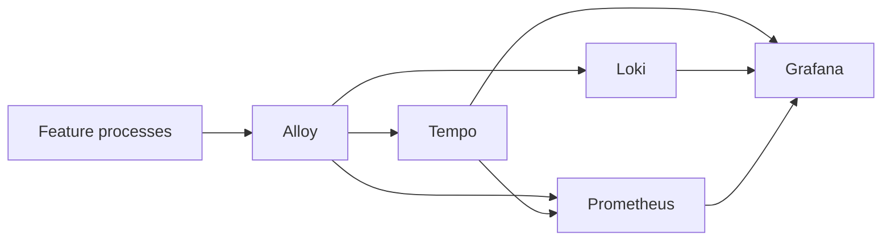
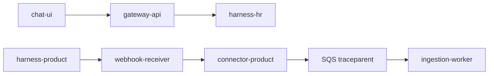

# ADR 0027: One telemetry path, and a service graph from span kind

Status: accepted for the POC.

## Context

Each process already exported OTLP when `OTEL_EXPORTER_OTLP_ENDPOINT` was set, and Alloy already stored traces in Tempo. The harnesses did not write JSON logs. Connector calls, the HR ACL re-check, and the product hook did not send `traceparent`, so those hops were missing from the trace. Tempo stored spans and did not produce a service graph. [ADR 0009](0009-observability-stack.md) chose the stack. This record says how the spans join up.

## Decision

`service.name` is the Compose service name. `trust_area` is `frontend`, `access`, `ingestion`, or `sources`. Every feature process calls `shared.logging.configure` and `shared.telemetry.init_telemetry`. Logs stay JSON on stdout. `trace_id` and `span_id` stay in the line.

An outbound HTTP call opens a client span, sets `peer.service` to the other process, and sends `trace_headers()`. The receiving HTTP middleware continues that parent as a server span. A queue publish is a producer span. A consume is a consumer span. The service graph uses those four kinds. Other spans stay internal.

Tempo's metrics generator runs the `service-graphs`, `span-metrics`, and `local-blocks` processors. The first two remote-write to Prometheus. `local-blocks` answers TraceQL metrics queries such as `| rate()`, which Traces Drilldown runs. Grafana's Tempo datasource reads that Prometheus for the node graph, and it keeps the existing link from a trace to Loki. The boards are the overview, the platform board, the traces board, one board per component, and `kbs-service-graph`.

A chat question is the left-hand trace. An object change is the right-hand trace. They are not the same trace. The queue is the link inside the second one.

## Alternatives rejected

- A second collector or a second trace store. Alloy and Tempo already hold the spans.
- Deriving the graph from log lines. The span parent is the edge. A log line is not.
- Leaving every span internal. Tempo ignores those for the service graph.
- Replacing the drawio architecture set. Those pictures are a different subject. New observability pictures are mermaid.

## Consequences

- A new HTTP hop that should appear on the graph needs a client span and `trace_headers()`, and the server process must already use the HTTP middleware.
- A malformed `traceparent` starts a new trace. The call still succeeds.
- Span metrics and the service graph show up after Tempo flushes, on the order of the 15 second collection interval plus the 10 second edge wait.
- The names are in [observability/metrics.md](../../observability/metrics.md).

## Production path

Same generator, remote-writing to the production Prometheus or Grafana Cloud. No new store.
